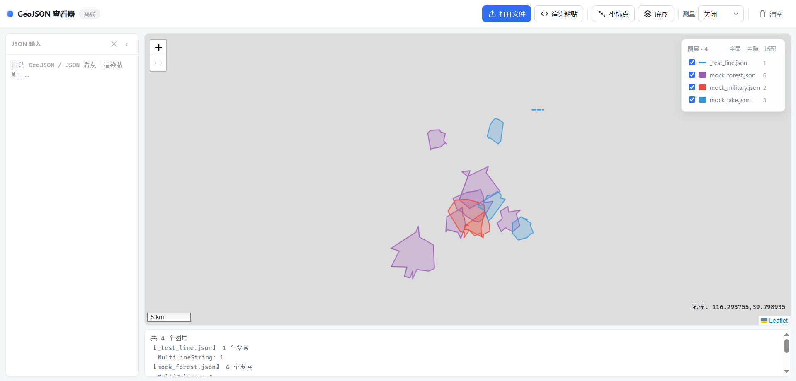

# GeoJSON Viewer

一个**离线、单文件**的 GeoJSON 查看器。拖进文件或粘贴 JSON，多图层可以单独配色、改名、删除、取景，还能量距离和面积。



<details>
<summary><b>English</b></summary>

An offline, single-file GeoJSON viewer. One `index.html` plus a vendored Leaflet —
no build step, no CDN, no install, no network. Load several files (or paste JSON)
and each becomes its own layer you can toggle, recolor, rename, delete and zoom to.
Also measures straight / polyline distances and polygon areas, optionally overlays
every coordinate point, and copies `lng,lat` from any popup.

Built for air-gapped machines: double-click the file and it works. WGS84 lon/lat
only (GeoJSON's own convention) — no reprojection. The basemap button needs network;
everything else does not.

The rest of this README is in Chinese, matching the UI.

</details>

## 它和在线工具的区别

在线 GeoJSON 站点（geojson.io 那一类）都要联网、要上传你的数据。这个工具：

- **一个 HTML 文件**，Leaflet 内置在仓库里，**不依赖 CDN**
- **双击就能用**，没有构建步骤、不用装任何东西、不用起服务
- 数据**不出本机**，内网/离线机器上照样打开

代价是功能只做**看图**这一件事——它不是编辑器。

## 快速开始

**双击 `index.html`。** 完。不需要 Node、不需要 Python、不需要联网。

（如果你想用 `file://` 之外的方式打开，任何静态服务器都行；但没必要。）

## 能做什么

**载入**

- 「打开文件」可**一次选多个** GeoJSON，各自成为一个图层
- 「渲染粘贴」把 JSON 贴进左侧输入框再渲染；粘贴的图层会自动编号（`粘贴 1`、`粘贴 2`…）
- 接受 FeatureCollection / Feature / 单个 Geometry

**图层面板**（右上角卡片，有图层时出现）

- 每行可**显示 / 隐藏**、**改名**、**换颜色**、**删除**
- 点图层名 → **缩放到该图层**（图层被隐藏时会先帮你显示出来）
- 卡片头有 `全显` / `全隐` / `适配`（缩放到可见图层）
- 删除带 **8 秒撤销**——粘贴进来的图层没有文件兜底，删错了还来得及

**量算与辅助**

- 「测量」：直线距离 / 折线距离 / 面积（折线与面积双击结束，可连续测）
- 「坐标点」：把每个要素的坐标点都标出来
- 鼠标位置实时显示 `经度,纬度`（右下角）；要素弹窗里有「复制坐标」
- 「底图」：叠加 OSM 在线瓦片（**默认关闭**，因为离线时它取不到图）

**要素弹窗**

点任意要素会列出它的全部属性，**照原样显示**——不解析、不翻译、不做字段名美化。

## 图层面板怎么用

```
图层 · 2                       全显  全隐  适配
─────────────────────────────────────────────
[☑] [●] 主干道路        3      ✕
[☑] [●] 粘贴 2          5      ✕
```

从左到右是**"常用 → 危险"**的顺序，为的是不误点：

| 元素 | 行为 |
|---|---|
| `[☑]` | 显示 / 隐藏 |
| `[●]` 色块 | 打开设置浮窗：**改名 + 换色**（16 个预设色 + 自定义） |
| 图层名 | 点击**缩放到该图层** |
| 数量 | 只读 |
| `✕` | **只在鼠标移到该行时才出现**，悬停变红 |

色块的形状也在说明几何类型：**纯线图层是细线，点/面是实心块**。

换色给的是**挑好的 16 个预设色**（彼此区分度高），而不是自由取色器——自由取色很容易选出两个几乎分不清的蓝，对看数据是负作用。真要匹配配色，浮窗底部还有自定义。

## 已知限制

- **是查看器，不是编辑器**：不能修改几何、不能另存。图上量出来的结果也不落盘
- **不做坐标转换**：按 GeoJSON 规范只认 WGS84 的 `[经度, 纬度]`。如果是别的坐标系（如投影坐标），图会画到错误的位置
- **底图需要联网**：只有「底图」那一个按钮走在线瓦片；其余功能（拖入文件、图层操作、量算、坐标）完全离线
- **超大文件会慢**：所有要素都交给 Leaflet 渲染，几十万要素量级会卡。没有做抽稀或矢量瓦片
- **只认 GeoJSON**：不符合 GeoJSON 结构的普通 JSON 画不出来
- **不记住任何东西**：刷新即清空，不写 localStorage 也不写文件

## 文件

```
index.html     全部前端（单文件）
leaflet.js     内置的 Leaflet，不依赖 CDN
leaflet.css
images/        Leaflet 用到的图标资源
tests/         测试
```

## 测试

```bash
npm install     # 只为测试装 jsdom；运行时零依赖
npm test
```

测试在 jsdom 里跑，不需要浏览器。它用一个 Leaflet 替身，并且会**真正回放** `onEachFeature` 和 `style` 回调——否则弹窗内容和着色逻辑根本没被执行，断言会在空集合上假绿。覆盖：图层命名、删除与撤销、换色、点击取景、批量显隐、属性弹窗照原样列字段、色块形状随几何类型变化。

## 许可

[MIT](LICENSE)

---

同一套自用小工具里的另一个：[**raw-http-console**](https://github.com/Ing-la/raw-http-console) —— 显示 HTTP/SSE 服务端返回的原样字节。
